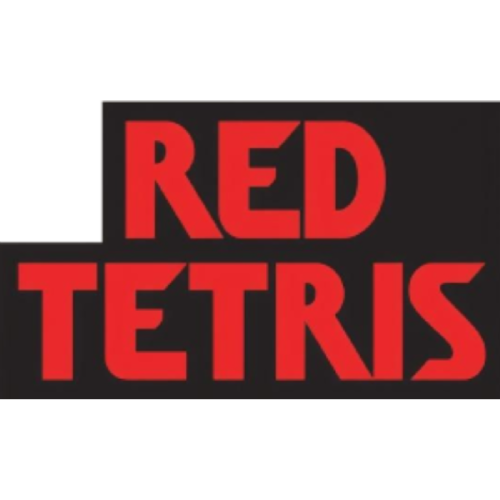

# Red Tetris

<div align="center">

[](https://redtetris.app)

[](https://redtetris.app)

**[English](#english) | [Francais](#francais)**

</div>

---

## English

Red Tetris is a multiplayer and solo Tetris game built with React, Vite, Redux, Socket.IO and Node.js.

### Live demo

Try the deployed game at **[https://redtetris.app](https://redtetris.app)**.

### Features

- Solo mode with configurable gravity, invisible pieces and time limit
- Multiplayer rooms with player names and passwords
- Real-time game synchronization
- Opponent board specters and blocked-line mechanics
- Responsive arcade interface

### Utility commands

These commands are kept for convenient local development:

```bash
npm install
npm update
npm audit
npm run coverage
```

### Development

```bash
npm run dev
```

### Production build

```bash
npm run build
```

Build the client:

```bash
cd client
npm run build
```

Install server dependencies for production:

```bash
cd server
npm install --production
```

### Docker deployment

The project includes Docker Compose, Nginx and Caddy:

- Caddy provides HTTPS automatically with Let's Encrypt.
- Nginx serves the built React application.
- Socket.IO traffic is proxied to the Node.js server.

Build and start the application:

```bash
docker compose up -d --build
```

Check the running services:

```bash
docker compose ps
docker compose logs -f
```

Stop the application:

```bash
docker compose down
```

### Required ports

The VPS must expose:

- `80/tcp` for HTTP and Let's Encrypt
- `443/tcp` for HTTPS

Ports `3000` and `3001` do not need to be public; Docker networking forwards the required traffic internally.

---

## Francais

Red Tetris est un jeu Tetris solo et multijoueur realise avec React, Vite, Redux, Socket.IO et Node.js.

### Demo en ligne

Essayez le jeu sur **[https://redtetris.app](https://redtetris.app)**.

### Fonctionnalites

- Mode solo avec gravite, pieces invisibles et duree configurables
- Salles multijoueur avec noms de joueurs et mots de passe
- Synchronisation des parties en temps reel
- Spectres des adversaires et lignes bloquees
- Interface arcade responsive

### Commandes pratiques

Ces commandes sont conservees pour faciliter le developpement local :

```bash
npm install
npm update
npm audit
npm run coverage
```

### Developpement

```bash
npm run dev
```

### Build de production

```bash
npm run build
```

Compiler le client :

```bash
cd client
npm run build
```

Installer les dependances du serveur en production :

```bash
cd server
npm install --production
```

### Deploiement Docker

Le projet contient Docker Compose, Nginx et Caddy :

- Caddy fournit automatiquement HTTPS avec Let's Encrypt.
- Nginx sert l'application React compilee.
- Le trafic Socket.IO est redirige vers le serveur Node.js.

Compiler et demarrer l'application :

```bash
docker compose up -d --build
```

Verifier les services actifs :

```bash
docker compose ps
docker compose logs -f
```

Arreter l'application :

```bash
docker compose down
```

### Ports requis

Le VPS doit exposer :

- `80/tcp` pour HTTP et Let's Encrypt
- `443/tcp` pour HTTPS

Les ports `3000` et `3001` n'ont pas besoin d'etre publics ; Docker gere le routage interne necessaire.
